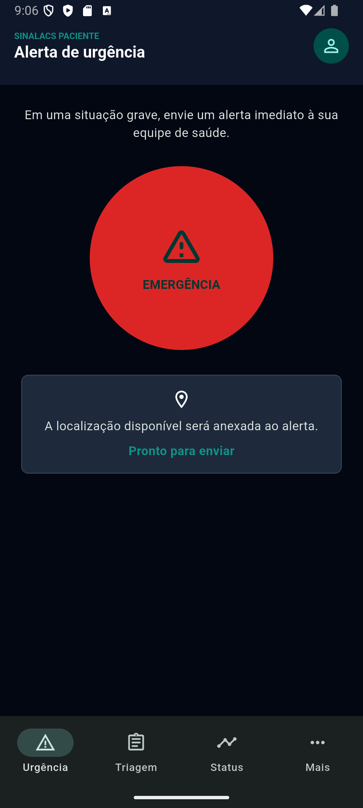

# Telas do App Paciente

Documentação visual do protótipo Flutter do paciente. As imagens foram capturadas no emulador Android `sdk gphone64 x86 64` usando somente dados sintéticos.

## Navegação

Os destinos principais são **Urgência**, **Triagem** e **Status**. O item **Mais** reúne **Perfil clínico**, **Lembretes** e **Meus dados** (o "Canal de dúvidas" foi removido em 2026-09-21 — contradizia a exclusão explícita de mensageria assíncrona do escopo MVP, `spec/PRD_system.md` §6.1).

## Autenticação inclusiva

A tela inicial pede CPF e data de nascimento e envia um código de uso único (OTP); não há senha. O primeiro acesso também pode vir de um convite em QR Code gerado pela equipe, que leva ao cadastro e ao aceite obrigatório dos Termos de Uso e da Política de Privacidade. Quem entra por OTP sem ter aceitado a versão vigente dos Termos recebe um aviso para aceitar — um aviso, não um bloqueio: o alerta de urgência nunca espera pelo aceite.

## Alerta de urgência

O botão circular de emergência pede confirmação e então cria um alerta vermelho real no backend (`alerts.createRedAlert`), idempotente, publicado para o ACS da microárea. A localização, quando disponível, segue como hash (`locationHash`, para deduplicar) e como uma célula de baixa resolução (~1,1 km, `locationCell`), legível pelo servidor, para o mapa do ACS desenhar uma área de incerteza — nunca as coordenadas exatas. A confirmação de recebimento pela equipe aparece na aba Status.

## Triagem rápida

Seis perguntas de sim ou não (dor no peito, falta de ar, sangramento, fraqueza intensa ou desmaio, febre, vômitos que não param), uma por etapa, com indicador de progresso. O risco é calculado pelo servidor (`triage.evaluate`), de forma determinística, e não pode ser editado pela pessoa usuária. Ao finalizar, encaminha para o acompanhamento da solicitação.

## Perfil clínico

Permite marcar condições crônicas (diabetes, hipertensão, uso contínuo de insulina) e mostra o estado ativo ou inativo de cada uma. Desde 2026-09-21, lê e grava de verdade em `patients.myChronicConditions`/`updateChronicConditions`, cifrado em repouso (AES-256-GCM) — não é mais estado só do protótipo.

## Acompanhamento de solicitação

Mostra o último alerta da pessoa a partir do backend (`alerts.statusFor`): a classificação de risco e o estado — `Enviado — aguardando confirmação da equipe`, `Recebido pela equipe de saúde`, `Atendimento concluído` ou `Encaminhado para o SAMU` —, com os horários de disparo e de confirmação. Atualiza ao abrir a aba, a cada 5 minutos e pelo botão manual.

## Lembretes

Lista lembretes de medicamentos e de rotina, com controles de ativação; cada lembrete ativo agenda uma notificação local do sistema. Avisos à comunidade enviados pela equipe chegam por push (Gorush + FCM).

## Meus dados

Painel de direitos LGPD (adicionado em 2026-09-21): confirmação de que os dados do paciente estão sendo tratados, o cadastro (nome, data de nascimento, contato de emergência, condições crônicas), o histórico de consentimentos e o histórico de classificação de risco (triagens e alertas — nunca o conteúdo bruto de uma triagem nem a localização de um alerta). Um botão copia tudo como JSON para a área de transferência, para a pessoa guardar ou compartilhar onde quiser.

## Referências

- [Implementação Flutter](../apps/patient/lib/app/app.dart)
- [Protótipos de referência](../spec/ui_paciente)
- [Guia visual](../spec/ui_design.md)
