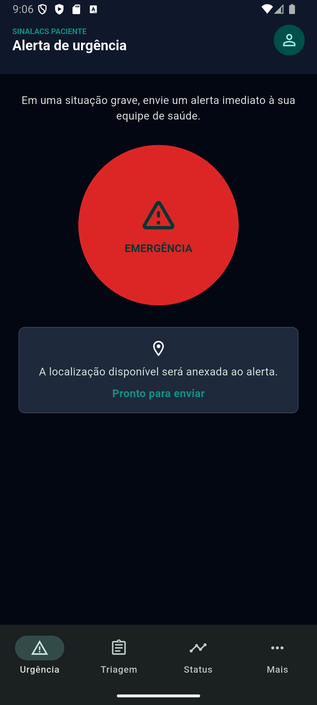

# Telas do App Paciente

> Conteúdo educativo. Não substitui atendimento profissional. Emergência: ligue 192.
>
> No piloto educativo, o alerta vira **pedido de contato com o agente participante**, sem rótulo de urgência, e a autoavaliação mostra três saídas em vez de classificação de risco (mudanças C-04 e C-08 de [`docs/escopo/mudancas-de-codigo-recomendadas.md`](escopo/mudancas-de-codigo-recomendadas.md)); as telas abaixo mostram o protótipo como está.

Documentação visual do protótipo Flutter do paciente. As imagens foram capturadas no emulador Android `sdk gphone64 x86 64` usando somente dados sintéticos.

## Navegação

Os destinos principais são **Contato** (antes "Urgência"; renomeado na C-04), **Triagem** e **Status**. O item **Mais** reúne **Perfil clínico**, **Lembretes** e **Meus dados** (o "Canal de dúvidas" foi removido em 2026-09-21 — contradizia a exclusão explícita de mensageria assíncrona do escopo MVP, `spec/PRD_system.md` §6.1).

## Autenticação inclusiva

A tela inicial pede CPF e data de nascimento e envia um código de uso único (OTP); não há senha. O primeiro acesso também pode vir de um convite em QR Code gerado pela equipe, que leva ao cadastro e ao aceite obrigatório dos Termos de Uso e da Política de Privacidade. Quem entra por OTP sem ter aceitado a versão vigente dos Termos recebe um aviso para aceitar — um aviso, não um bloqueio: o alerta de urgência (no piloto: pedido de contato com o agente participante, sem rótulo de urgência; o SinalACS não é serviço de emergência — ligue 192) nunca espera pelo aceite.

## Alerta de urgência (no piloto: pedido de contato com o agente participante, sem rótulo de urgência; o SinalACS não é serviço de emergência — ligue 192)

> A captura acima é anterior à C-04 (#127) e ainda mostra o botão circular "EMERGÊNCIA"; falta refazê-la no aparelho.

Desde a C-04 (#127) a aba se chama **Contato**. No topo, antes de qualquer pedido, um cartão diz "Em risco de vida, ligue 192 (SAMU). O SinalACS não é um serviço de emergência." com o botão **Ligar 192** (abre o discador com `tel:192`, nunca liga sozinho). Abaixo, **Pedir contato ao agente**, sem cor clínica nem rótulo de urgência, pede confirmação ("Enviar pedido") e então cria o pedido no backend pelo mesmo `alerts.createRedAlert` de antes, idempotente e publicado para o agente da microárea — é isso que mantém a INV-03 (o pedido nunca some em silêncio). O estado diz "Pedido enviado ao agente. Acompanhe a resposta na aba Status." (ou "Pedido registrado…" quando a publicação espera a rede), nunca que alguém já foi atendido. A localização, quando disponível, segue como hash (`locationHash`, para deduplicar) e como uma célula de baixa resolução (~1,1 km, `locationCell`), legível pelo servidor, para o mapa do ACS desenhar uma área de incerteza — nunca as coordenadas exatas. A confirmação de recebimento pela equipe aparece na aba Status.

## Triagem rápida

Seis perguntas de sim ou não (dor no peito, falta de ar, sangramento, fraqueza intensa ou desmaio, febre, vômitos que não param), uma por etapa, com indicador de progresso. Com sessão, o risco é calculado pelo servidor (`triage.evaluate`), de forma determinística, e não pode ser editado pela pessoa usuária. Sem conta, o botão **Autoavaliação (sem cadastro)** da tela de entrada abre a mesma sequência rodando no aparelho (C-11, #132): mesma árvore, nenhuma chamada de rede, nada gravado; o resultado diz que nada foi enviado e o botão é "Concluir". Ao finalizar, encaminha para o acompanhamento da solicitação. Desde a C-04 (#127), a saída de maior gravidade não mostra cartão de risco: abre em tela cheia a orientação **"Ligue 192 (SAMU) agora"**, com o botão Ligar 192, que só fecha por "Fechar esta orientação" (o voltar do sistema não fecha). Ela **não envia nada ao agente** e grava um evento na trilha local cifrada do aparelho (tipo, instante e versão do motor, sem respostas); depois a autoavaliação recomeça do zero. As outras duas saídas ainda mostram o cartão de risco antigo, até a C-08 (#130).

## Perfil clínico

Permite marcar condições crônicas (diabetes, hipertensão, uso contínuo de insulina) e mostra o estado ativo ou inativo de cada uma. Desde 2026-09-21, lê e grava de verdade em `patients.myChronicConditions`/`updateChronicConditions`, cifrado em repouso (AES-256-GCM) — não é mais estado só do protótipo.

## Acompanhamento de solicitação

Mostra o último pedido de contato da pessoa a partir do backend (`alerts.statusFor`), sem rótulo de risco nem de urgência (C-04, #127): `Enviado — aguardando o agente confirmar`, `Visto pelo agente participante`, `Encerrado pelo agente participante` (nunca "Atendido") ou `Repassado à coordenação do piloto`, com os horários de envio, de confirmação e de encerramento. Atualiza ao abrir a aba, a cada 5 minutos e pelo botão manual.

## Lembretes

Lista lembretes de medicamentos e de rotina, com controles de ativação; cada lembrete ativo agenda uma notificação local do sistema. Avisos à comunidade enviados pela equipe chegam por push (Gorush + FCM).

## Meus dados

Painel de direitos LGPD (adicionado em 2026-09-21): confirmação de que os dados do paciente estão sendo tratados, o cadastro (nome, data de nascimento, contato de emergência, condições crônicas), o histórico de consentimentos e o histórico de classificação de risco (triagens e alertas — nunca o conteúdo bruto de uma triagem nem a localização de um alerta). Um botão copia tudo como JSON para a área de transferência, para a pessoa guardar ou compartilhar onde quiser.

## Referências

- [Implementação Flutter](../apps/patient/lib/app/app.dart)
- [Protótipos de referência](../spec/ui_paciente)
- [Guia visual](../spec/ui_design.md)
